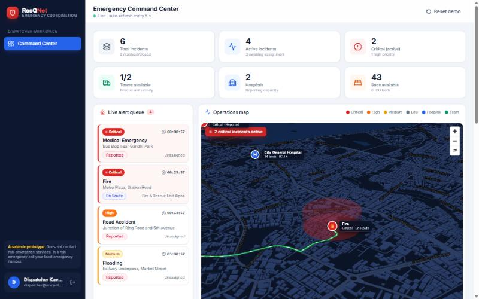
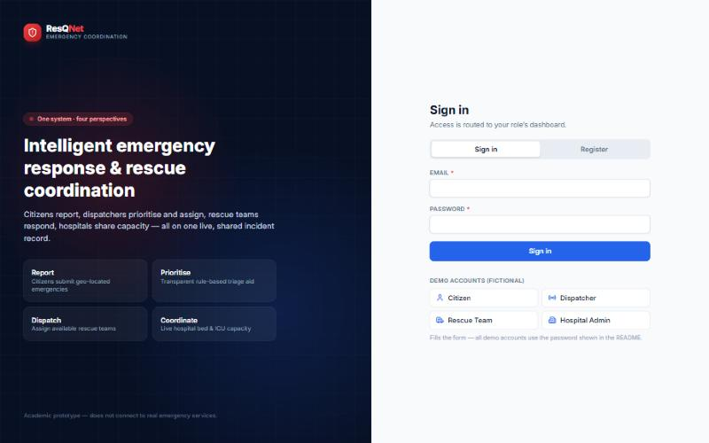
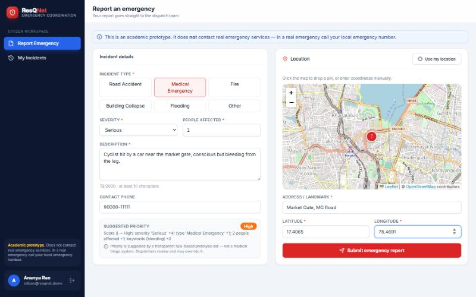
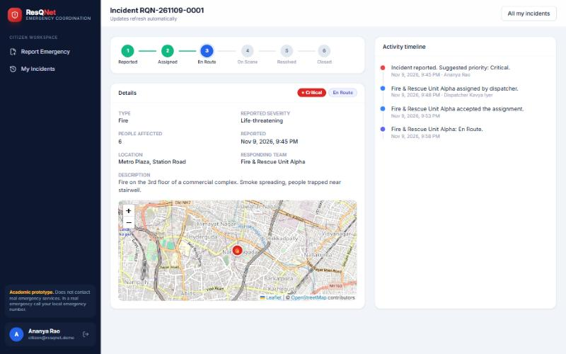
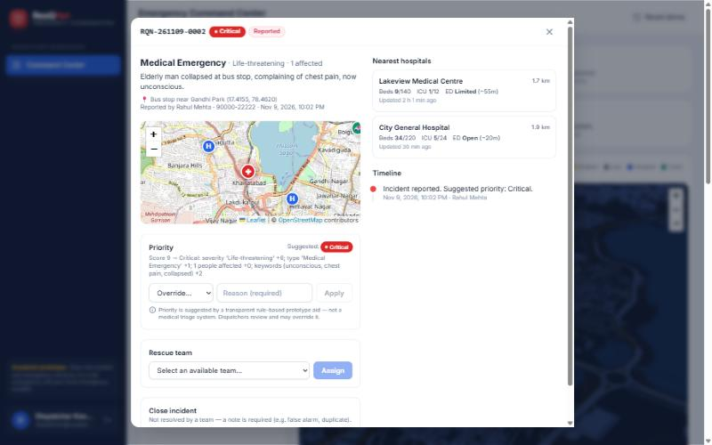
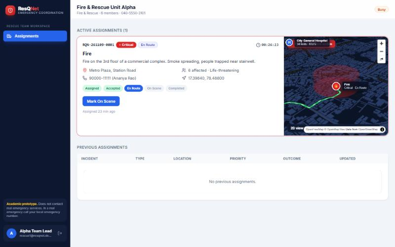
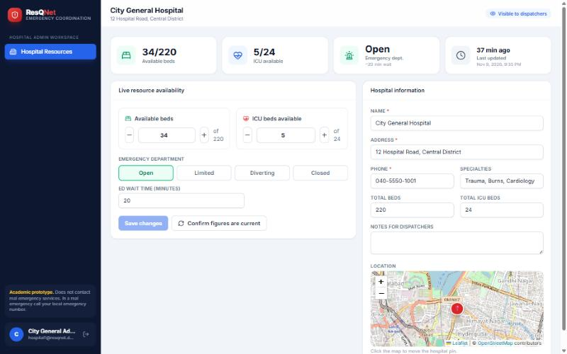
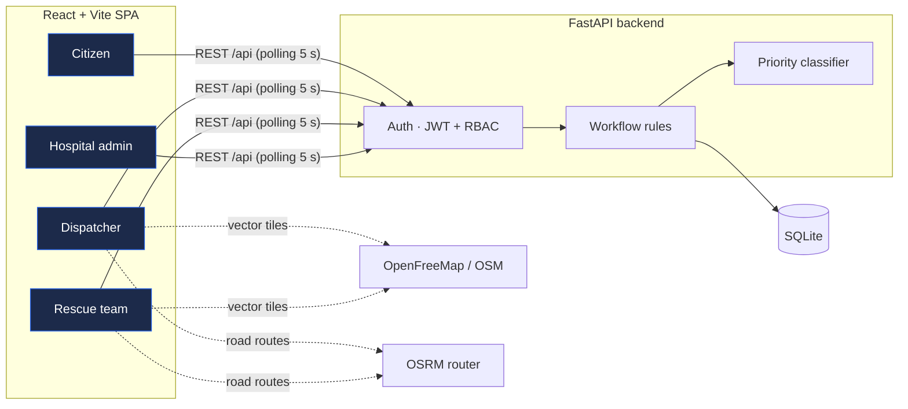
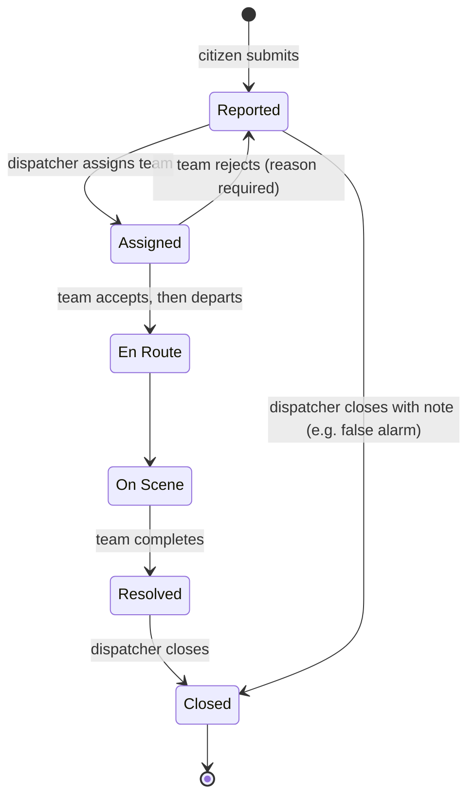
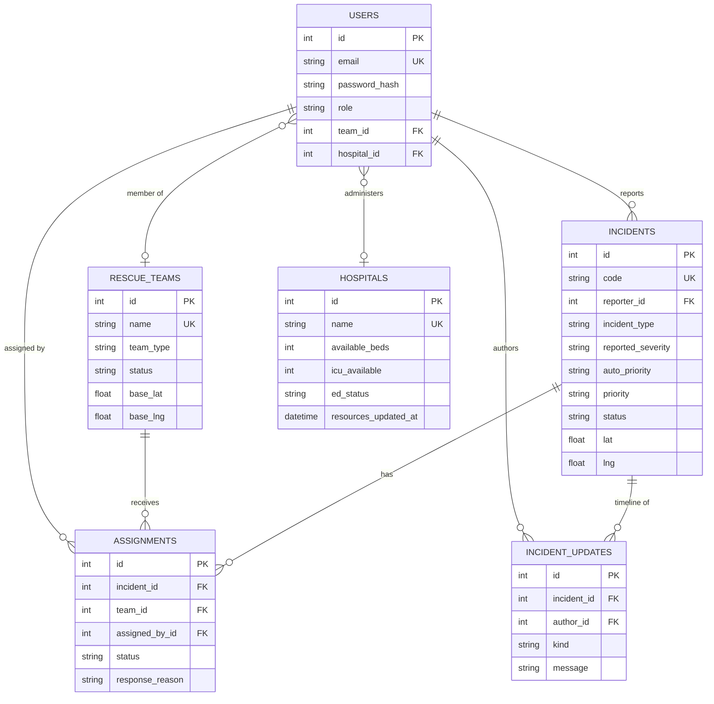

<div align="center">

# 🚨 ResQNet

### Intelligent Emergency Response & Rescue Coordination System

**One live incident record. Four roles. Five connected screens.**




</div>

> [!WARNING]
> **ResQNet is an academic prototype.** It never contacts real emergency services and never places real calls or sends real messages.
> Its priority classification is a transparent, rule-based **decision aid — not a medical triage system**. In a real emergency, call your local emergency number.

---

## Table of contents

- [Overview](#overview)
- [Features](#features)
- [Screenshots](#screenshots)
- [Architecture](#architecture)
- [Getting started](#getting-started)
- [Demo accounts & data](#demo-accounts--data)
- [Guided walkthrough](#guided-walkthrough)
- [Incident lifecycle](#incident-lifecycle)
- [Priority classification](#priority-classification)
- [Data model](#data-model)
- [API](#api)
- [Security](#security)
- [Testing](#testing)
- [Project structure](#project-structure)
- [Limitations & roadmap](#limitations--roadmap)
- [Acknowledgements](#acknowledgements)

---

## Overview

When an emergency happens, the people involved usually work from separate channels: a caller, a dispatcher, the crews in the field and the hospitals all keep their own view of what is going on. **ResQNet puts them on one shared incident record.** Each role sees it through its own screen:

| Role | Uses ResQNet to… |
|---|---|
| 🧑 **Citizen** | Report an emergency with a map location, get an incident ID and follow its status live |
| 🎧 **Dispatcher** | See every incident on a 3D operations map, check the suggested priority, assign rescue teams and close incidents |
| 🚑 **Rescue team** | Receive assignments, accept or reject them with a reason, and report En Route → On Scene → Completed |
| 🏥 **Hospital admin** | Publish available beds, ICU beds and emergency department status, which dispatchers and crews then see |

There is no mock data in the UI. Every screen reads from and writes to the same FastAPI backend and SQLite database, and the dashboards refresh automatically, so an action in one role appears in the others within seconds.

## Features

### 🧑 Citizen
- Self-registration and secure login
- Emergency report with incident type, severity, people affected and description
- Location from an **interactive map pin**, typed coordinates or the browser's geolocation
- **Live priority preview** that explains how the suggested priority was scored
- Unique incident ID (`RQN-YYMMDD-NNNN`) on submission
- *My Incidents* history, with a **progress stepper** and a full **activity timeline** for each incident

### 🎧 Dispatcher: the command center
- KPI cards: total, active and critical incidents, unassigned incidents, available teams, hospitals, free beds and ICU beds
- **Live alert queue** sorted by priority, with a running timer since each report
- **3D operations map** with:
  - extruded city buildings and red hazard zones around critical incidents
  - **road-following route lines** from each responding team's base, with a moving vehicle and an ETA label
- Incident table with filters by **priority, type and status**
- Incident review panel:
  - **override the priority** with a recorded reason
  - **assign an available team**, with each team's distance shown
  - **nearest hospitals** with live capacity
  - full timeline
  - **close** the incident
- Rescue team status and hospital capacity panels
- Charts of active incidents by priority and reports over the last 7 days
- One-click **demo reset**

### 🚑 Rescue team
- Active assignments with incident details, a reporter contact and a **3D route map** that includes nearby hospital capacity
- **Accept**, or **reject with a mandatory reason** (the incident then goes back to the dispatcher queue)
- Status steps in order: **Accepted → En Route → On Scene → Completed**. Skipping a step is rejected.
- History of previous assignments with their outcomes

### 🏥 Hospital administrator
- Quick +/- controls for **available beds** and **ICU beds**
- **Emergency department** status (Open, Limited, Diverting, Closed) and wait time
- Editable hospital profile: name, address, phone, specialties, notes, and a map pin for its location
- Every save records a **resource timestamp**. *Confirm figures are current* re-publishes the same numbers with a new timestamp.

## Screenshots

| Login & role-based access | Citizen emergency report |
|---|---|
|  |  |
| **Citizen incident tracking** | **Dispatcher incident review** |
|  |  |
| **Rescue team assignments** | **Hospital resource management** |
|  |  |

## Architecture



| Layer | Technology |
|---|---|
| **Frontend** | React 19, Vite 6, TypeScript, Tailwind CSS, React Router, Recharts, lucide-react |
| **Maps** | MapLibre GL with [OpenFreeMap](https://openfreemap.org) OSM vector tiles for the 3D maps; Leaflet with OpenStreetMap tiles for the 2D maps; the public [OSRM](https://project-osrm.org) router for road routes |
| **Backend** | Python FastAPI, SQLAlchemy 2, Pydantic 2, Uvicorn |
| **Database** | SQLite with foreign keys and CHECK constraints enforced |
| **Auth** | scrypt password hashing (Python standard library), HS256 JWT bearer tokens, role-based dependencies on every endpoint |
| **Testing** | pytest + FastAPI TestClient against a throwaway database |

## Getting started

### Prerequisites

- **Python 3.11+**
- **Node.js 18+** and npm
- Internet access for map tiles and routing. Everything else runs locally.

### 1 · Backend

```bash
cd backend
python -m venv .venv
```

Activate the virtual environment:

```bash
source .venv/bin/activate          # macOS / Linux
```

```bash
.venv\Scripts\activate             # Windows
```

```bash
pip install -r requirements.txt
cp .env.example .env               # then set SECRET_KEY, see below
uvicorn app.main:app --reload --env-file .env --port 8000
```

On first start the database tables are created and the **demo data is loaded automatically**.
The API runs at <http://localhost:8000>, with interactive documentation at <http://localhost:8000/docs>.

### 2 · Frontend (in a second terminal)

```bash
cd frontend
npm install
npm run dev
```

Open **<http://localhost:5173>**. The Vite dev server proxies `/api` to the backend, so no CORS setup is needed.

For a production build, run `npm run build`. The output goes to `frontend/dist`.

### Configuration

Backend settings (`backend/.env`, see [`.env.example`](backend/.env.example)):

| Variable | Default | Purpose |
|---|---|---|
| `SECRET_KEY` | *(random per process)* | Signs login tokens. **Set this**, or logins won't survive a restart. Generate one with `python -c "import secrets; print(secrets.token_urlsafe(48))"`. |
| `ACCESS_TOKEN_MINUTES` | `480` | How long a login token stays valid |
| `DATABASE_URL` | `backend/resqnet.db` (SQLite) | SQLAlchemy database URL |
| `CORS_ORIGINS` | `http://localhost:5173` | Comma-separated origins allowed to call the API directly |
| `SEED_ON_STARTUP` | `true` | Load the demo data when the database is empty |
| `DEMO_MODE` | `true` | Allow dispatchers to reset all data through `POST /api/demo/reset` |

Frontend settings (`frontend/.env`, see [`.env.example`](frontend/.env.example)):

| Variable | Default | Purpose |
|---|---|---|
| `VITE_PROXY_TARGET` | `http://127.0.0.1:8000` | Where the dev server proxies `/api` |
| `VITE_API_URL` | *(empty)* | API origin, for when the built frontend is served separately from the API |

## Demo accounts & data

All demo accounts use the password **`Demo@1234`**. The login page also has one-click buttons that fill them in.

| Role | Email | Linked to |
|---|---|---|
| Citizen | `citizen@resqnet.demo` | Ananya Rao |
| Citizen | `citizen2@resqnet.demo` | Rahul Mehta |
| Dispatcher | `dispatcher@resqnet.demo` | Kavya Iyer |
| Rescue team | `rescue1@resqnet.demo` | Fire & Rescue Unit Alpha |
| Rescue team | `rescue2@resqnet.demo` | Ambulance Unit Medic-7 |
| Hospital admin | `hospital1@resqnet.demo` | City General Hospital |
| Hospital admin | `hospital2@resqnet.demo` | Lakeview Medical Centre |

The seed contains **2 hospitals, 2 rescue teams and 6 incidents**. Together they cover every priority level (Critical, High, Medium, Low) and every stage of the lifecycle: unassigned, en route, resolved and closed. All people, organisations and phone numbers are fictional.

**Resetting the data**

| How | Command or action |
|---|---|
| CLI | `cd backend && python -m app.seed` |
| UI | Dispatcher dashboard → **Reset demo** (needs `DEMO_MODE=true`) |
| Manual | Delete `backend/resqnet.db` and restart the backend |

> [!TIP]
> Each browser tab keeps its own login. Open four tabs, sign in as a different role in each, and watch an incident move through the whole system in real time.

## Guided walkthrough

1. **Citizen:** open *Report Emergency*, choose a type and severity, describe the incident and drop a pin on the map. The suggested priority and its scoring update as you type. Submit to receive an incident ID.
2. **Dispatcher:** within 5 seconds the incident appears in the alert queue, on the 3D map and in the table. Open it to review the details, override the priority if needed (a reason is required), compare the nearest hospitals and **assign** an available team.
3. **Rescue team:** the assignment appears on the team's dashboard. **Accept** it, then advance it to **En Route**. A road route, a moving vehicle and an ETA label now appear on both the rescue team's map and the dispatcher's.
4. **Citizen:** *My Incidents* shows the status advancing on the stepper, with each step recorded in the timeline.
5. **Rescue team:** mark the job **On Scene**, then **Completed**. The team becomes available again.
6. **Dispatcher:** **close** the resolved incident.
7. **Hospital admin:** lower the ICU count or change the ED status and save. The dispatcher's capacity panel, the nearest-hospital list and the rescue team's map all show the new figures with a fresh timestamp.

## Incident lifecycle



The backend enforces these rules:
- A team can only be assigned while it is `available`. While it is assigned it is marked `busy`, and it becomes `available` again when it rejects or completes the job.
- An incident has at most one active team at a time.
- Rescue status updates must go in order; a skipped step returns **409 Conflict**.
- An incident can't be closed while a team is still working on it. Closing one that no team resolved requires a note.

Every state change is written to the `incident_updates` audit log, which is shown as the timeline.

## Priority classification

The classifier is in [`backend/app/classify.py`](backend/app/classify.py). It is a deliberately simple, explainable scoring model, and it shows its working for every incident.

| Factor | Points |
|---|---|
| Reported severity | Minor **0** · Moderate **2** · Serious **4** · Life-threatening **6** |
| Incident type | Building Collapse **3** · Fire **2** · Medical / Road Accident / Flooding **1** · Other **0** |
| People affected | ≥ 10 → **3** · 3–9 → **2** · 2 → **1** · 1 → **0** |
| Critical keywords in the description<br><sub>unconscious, not breathing, trapped, bleeding, explosion, cardiac, chest pain, child, spreading, collapsed, drowning, burn</sub> | **+2** |

| Score | ≥ 9 | 6 – 8 | 3 – 5 | < 3 |
|---|---|---|---|---|
| **Priority** | 🔴 Critical | 🟠 High | 🟡 Medium | ⚪ Low |

Each incident stores both the suggested priority (`auto_priority`) and the working priority (`priority`), along with the score and a plain-English explanation. A dispatcher override sets `priority_overridden` and records the reason in the timeline.

## Data model



The schema is defined in [`backend/app/db.py`](backend/app/db.py) and created by `init_db()`. Integrity is enforced in the database itself:
- SQLite foreign keys are turned on (`PRAGMA foreign_keys=ON`).
- **CHECK constraints** cover every enum, coordinate ranges, and available counts never exceeding the totals.
- A rescue user must belong to a team, and a hospital admin must belong to a hospital.

## API

The REST API is under `/api`. Interactive Swagger documentation is generated at **`/docs`**, and the full reference is in **[docs/API.md](docs/API.md)**.

| Area | Endpoints |
|---|---|
| Auth | `POST /auth/register` · `POST /auth/login` · `GET /auth/me` |
| Incidents | `POST /incidents` · `GET /incidents` · `GET /incidents/{id}` · `POST /classification/preview` · `GET /classification/rules` |
| Dispatcher | `PATCH /incidents/{id}/priority` · `POST /incidents/{id}/assign` · `POST /incidents/{id}/close` · `GET /stats` · `GET /teams` · `POST /demo/reset` |
| Rescue | `GET /assignments/mine` · `POST /assignments/{id}/respond` · `POST /assignments/{id}/status` |
| Hospitals | `GET /hospitals` · `GET /hospitals/mine` · `PUT /hospitals/mine` |

## Security

| Concern | Implementation |
|---|---|
| Password storage | **scrypt** with a random 16-byte salt per user, verified with a constant-time comparison. Hashes are never returned by any endpoint. |
| Sessions | Signed **JWT** bearer tokens with an expiry. Secrets are loaded from a git-ignored `.env` file. |
| Authorization | Every endpoint declares the roles it allows (`require(...)`). The wrong role gets **403**. |
| Data scoping | Citizens see only their own incidents. Rescue teams see only their own assignments. Hospital admins can only edit their own hospital, and that endpoint takes no hospital id at all. Records you aren't allowed to see return **404**, so their existence isn't revealed. |
| Provisioning | Only citizen accounts can self-register. Staff accounts are created by the seed or by an administrator. |
| Input validation | Pydantic schemas check enums, lengths, ranges and totals, and database constraints back them up. |

## Testing

```bash
cd backend
python -m pytest -q          # end-to-end API tests on a throwaway database
python -m app.classify       # classifier self-check
```

The suite covers:

- **Authentication:** wrong password, invalid token, duplicate and weak registrations
- **Role isolation:** forbidden endpoints for each role, and citizens unable to see each other's incidents
- **Validation:** short descriptions, out-of-range coordinates, unknown incident types
- **Classification:** each priority band
- **Full workflow:**
  1. report the incident
  2. override its priority
  3. try to assign a busy team (refused)
  4. assign an available team
  5. reject with a reason
  6. reassign and accept
  7. try to skip a step (refused) and to close too early (refused)
  8. advance step by step, checking that the citizen and dispatcher see each status
  9. confirm the team is freed, then close, and check the audit timeline
- **Hospital updates:** totals enforced, timestamp updated, visible to dispatchers and rescue teams, read-only for crews

## Project structure

```
resqnet/
├── backend/
│   ├── app/
│   │   ├── main.py          # API routes and workflow rules
│   │   ├── db.py            # engine, ORM models, constraints
│   │   ├── security.py      # scrypt hashing, JWT, role dependencies
│   │   ├── classify.py      # rule-based priority classifier
│   │   ├── schemas.py       # request validation and response models
│   │   └── seed.py          # fictional demo data and reset
│   ├── tests/test_api.py
│   ├── requirements.txt
│   └── .env.example
├── frontend/
│   ├── src/
│   │   ├── api.ts           # typed API client and helpers
│   │   ├── auth.tsx         # session context and live-polling hook
│   │   ├── components/
│   │   │   ├── Layout.tsx   # navy sidebar shell
│   │   │   ├── Map3D.tsx    # MapLibre 3D map, routes, vehicles, hazard zones
│   │   │   ├── MapView.tsx  # Leaflet 2D map and location picker
│   │   │   └── ui.tsx       # cards, badges, buttons, modal, timeline
│   │   └── pages/
│   │       ├── Login.tsx       # screen 1
│   │       ├── Citizen.tsx     # screen 2: report, history, tracking
│   │       ├── Dispatcher.tsx  # screen 3: command center
│   │       ├── Rescue.tsx      # screen 4
│   │       └── Hospital.tsx    # screen 5
│   └── .env.example
└── docs/
    ├── API.md
    └── screenshots/
```

## Limitations & roadmap

| Current prototype behaviour | Upgrade path |
|---|---|
| Dashboards poll every 5 seconds | WebSocket or server-sent events push |
| One active team per incident | Multi-unit responses |
| Vehicle position is estimated from the time since dispatch and the routed travel time | Live GPS from crew devices |
| Most OpenStreetMap buildings have no height tag, so those get a consistent placeholder height (not real elevation data) | A building-height dataset |
| Routes use the public OSRM demo server, with a straight-line fallback | A self-hosted routing engine |
| Tables are created with `create_all` | Alembic migrations |
| No login rate-limiting, and no admin UI for staff accounts | Rate limiting and an account management console |
| SQLite | PostgreSQL. SQLAlchemy makes this a change to `DATABASE_URL`. |

If a device has no WebGL support, the 3D maps automatically fall back to the 2D Leaflet map.

## Acknowledgements

- Map data © [OpenStreetMap](https://www.openstreetmap.org/copyright) contributors
- Vector tiles by [OpenFreeMap](https://openfreemap.org)
- Routing by [OSRM](https://project-osrm.org)
- Rendering by [MapLibre GL JS](https://maplibre.org) and [Leaflet](https://leafletjs.com)
- Charts by [Recharts](https://recharts.org), icons by [Lucide](https://lucide.dev)

<div align="center">
<sub>Built as an academic software prototype. Not for operational emergency use.</sub>
</div>
